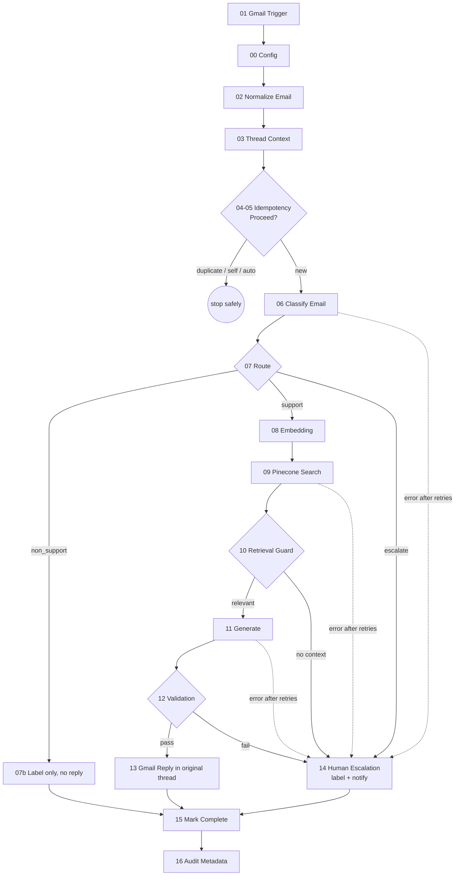

# 📬 AI Customer Support Email Automation (n8n)

A guarded, fail-closed n8n workflow that turns an incoming Gmail support email into either a **grounded, threaded reply** or a **controlled human escalation**. Gmail is the inbox, n8n orchestrates, OpenAI classifies and drafts, and Pinecone supplies the approved knowledge (RAG).

> **Status:** MVP v1.0. Use a dedicated test mailbox before pointing this at real customer mail.

* * *

## 📋 Features

- **Gmail ingestion** with normalised sender, recipients, subject, plain-text body, `messageId`, `threadId` and timestamp (HTML stripped safely).
- **Bounded thread context**: only the last N prior messages of the same thread are used, never the whole mailbox.
- **Idempotency**: `messageId` is the key (`PROCESSING` → `REPLIED` / `ESCALATED` / `NON_SUPPORT`); duplicates, self-sent and `Auto-Submitted` mail stop safely.
- **Structured AI classification** (`category`, `confidence`, `intent`, `reason`, `requires_human`) with a configurable confidence threshold.
- **RAG grounding**: OpenAI embeddings → Pinecone Top-K → relevance guard that rejects weak matches.
- **Grounded generation** that may only use retrieved knowledge and must cite the chunks it used.
- **Response validation**: non-empty, cited chunks only, no prompt/secret leakage, every number and URL traceable to the source, valid recipient.
- **Threaded reply** in the original Gmail conversation, or **human escalation** (label + notification) with a machine-readable reason. The AI never replies when it cannot answer safely.
- **Bounded retries** on OpenAI and Pinecone, no retry on the Gmail send (avoids duplicate replies), and a dedicated **error workflow**.
- **Audit metadata** (IDs, decisions, timings; no email bodies) and prompt-injection-resistant prompts (system rules, customer email and knowledge are separated and marked untrusted).

* * *

## 🔄 How it works



Escalation triggers: low classifier confidence, sensitive intent (legal, refund, payment dispute, security incident, account deletion by default), malformed AI output, no relevant knowledge, failed validation, or a provider failure after retries.

* * *

## 🛠️ Tech Stack

| Layer | Technology |
|---|---|
| Orchestration | n8n (Cloud or self-hosted) |
| Email | Gmail / Google Workspace (OAuth2) |
| Classification & generation | OpenAI chat models (configurable, called through the HTTP Request node) |
| Embeddings | OpenAI `text-embedding-3-small` (must match the index) |
| Vector database | Pinecone (serverless) |
| State / idempotency | n8n workflow static data (MVP) |
| Observability | n8n executions, Error Trigger workflow, audit log line |

* * *

## 📁 Repository Structure

```
├── README.md
├── workflow/
│   ├── workflows/
│   │   ├── support-email-automation-v1.0.json   # Main workflow (import into n8n)
│   │   └── error-handler-v1.0.json              # Error Trigger workflow
│   ├── src/                                     # Source of every Code node
│   ├── docs/setup-guide.md                      # Credentials, config matrix, handover
│   └── tools/
│       ├── build.py                             # Regenerates workflow JSON from src/
│       └── load_test_kb.py                      # Creates a test Pinecone index + sample KB
```

* * *

## ⚙️ Configuration

All thresholds and client values live in the **`00 - Config`** node (the error workflow has its own `E0 - Config`). Nothing is hard-coded elsewhere, and no secrets are stored in the workflow; credentials use n8n's credential store.

| Key | Default | Meaning |
|---|---|---|
| `mailbox` | `support@example.com` | Monitored mailbox (also used to ignore self-sent mail) |
| `confidenceThreshold` | `0.8` | Auto-route only when support and confidence is at least this |
| `topK` / `minScore` | `5` / `0.5` | Pinecone results kept / minimum similarity (tune on your knowledge base) |
| `pineconeIndexHost`, `pineconeNamespace`, `metadataTextField` | placeholders / `text` | Where the knowledge lives |
| `maxThreadMessages` | `5` | Prior thread messages used as context (`0` disables) |
| `classifierModel`, `generationModel`, `embeddingModel` | `gpt-4o-mini`, `gpt-4o`, `text-embedding-3-small` | Configure to your approved models and cost ceiling |
| `sensitiveIntents` | `legal,refund,payment_dispute,security_incident,account_deletion` | Intents that never get an automated reply |
| `nonSupportAction` | `label` | MVP labels non-support mail and does not reply |
| `escalationEmail`, label IDs | placeholders | Human escalation destination and Gmail labels |
| Retries | 3 tries, 3 s wait | Node settings on OpenAI and Pinecone nodes; Gmail Reply has none by design |

Open business decisions (mailbox and trigger criteria, non-support action, escalation destination, Pinecone namespace/metadata, thread depth, production models and cost ceiling) are deliberately left as configuration, not buried in node logic.

* * *

## 🚀 Getting Started

**Prerequisites:** an n8n instance, a dedicated **test** Gmail mailbox, an OpenAI API key with credit, a Pinecone account, and Node.js + Python 3 if you want to run the tooling.

1. **Import** `workflow/workflows/error-handler-v1.0.json` first, then `support-email-automation-v1.0.json` (Workflows → `⋯` → Import from file).
2. **Create credentials** in n8n and select them on the nodes:
   - Gmail OAuth2 (the support mailbox)
   - OpenAI API
   - Header Auth for Pinecone: **Name** `Api-Key`, **Value** your Pinecone key
3. **Load a knowledge base.** For a quick test, run the sample loader (keys come from environment variables only):
   ```powershell
   $env:OPENAI_API_KEY = "sk-..."
   $env:PINECONE_API_KEY = "pcsk_..."
   pip install requests
   python workflow/tools/load_test_kb.py
   ```
   It prints the index host and namespace to paste into `00 - Config`.
4. **Configure** `00 - Config` and `E0 - Config`, create the Gmail labels, and pick them in nodes `07b` and `14b`.
5. **Link the error workflow** in the main workflow's Settings, and set *Save successful executions* to **Do not save** to avoid storing email content.
6. **Smoke test** by emailing the mailbox from another address and clicking **Execute workflow**. Publish when you are ready to go live, since idempotency state only persists for a published workflow.

Full detail (permissions, config matrix, handover, recovery): [`workflow/docs/setup-guide.md`](workflow/docs/setup-guide.md).

* * *

## 📦 Production Notes

- **Idempotency** lives in workflow static data: fine for a pilot, but re-importing or clearing the workflow loses it. Move it to a Data Table or external database for real volume.
- **Google OAuth:** a custom OAuth client left in *Testing* status expires tokens after 7 days. Use an Internal app for a Workspace mailbox.
- **Narrow the trigger** (`in:inbox -from:me` by default) to a label or support alias so only support mail is processed.
- **Replace test keys and the test index** before go-live, use a project-scoped OpenAI key with a spend limit, and restrict who can open execution history.
- **Editing:** `workflow/tools/build.py` regenerates `workflow/workflows/*.json` from `src/` and **overwrites** the files there, including any exports from n8n. Copy exports elsewhere first.

* * *

## 🔒 Security

- Secrets stay in n8n credentials; none are in prompts, Code nodes or the exported JSON.
- Customer email and retrieved knowledge are treated as untrusted input and cannot change routing.
- Logs and notifications carry IDs and reasons, not email bodies.
