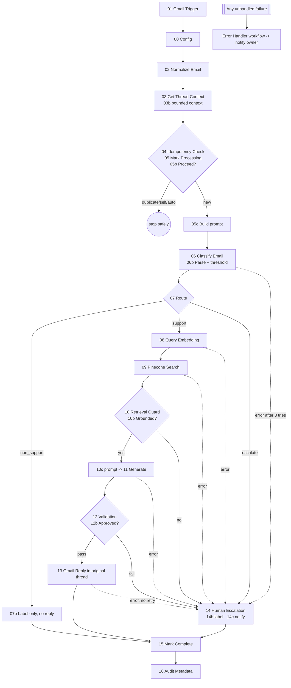

# AI Customer Support Email Automation v1.0 — Setup, Configuration & Handover

Acme Labs · MVP · n8n + Gmail + OpenAI + Pinecone

## 1. Package contents

| File | Purpose |
|---|---|
| `workflows/support-email-automation-v1.0.json` | Main workflow (import-ready, no secrets) |
| `workflows/error-handler-v1.0.json` | Error Trigger workflow (owner notification) |
| `src/*.js` | Source of every Code node (build input) |
| `tools/build.py` | Regenerates the JSON from `src/` |
| `tests/` | Offline simulator, 47-case validation, `results.md` |

## 2. Workflow diagram

## 3. Credentials (create in n8n, then map on import)

| Credential | n8n type | Notes / permissions |
|---|---|---|
| Gmail | Gmail OAuth2 API | Dedicated support mailbox. n8n's Gmail credential requests read/modify/compose/send scopes; restrict the OAuth client to the support mailbox / internal users. Needed: read messages + threads, reply/send, add labels. |
| OpenAI | OpenAI API | Used by HTTP nodes 06, 08, 11 (predefined credential type). Project-scoped key with a spend limit. |
| Pinecone | Header Auth | Name `Api-Key`, value = Pinecone key. Used by node 09. |

Import order: import the error handler first, then the main workflow, then open each Gmail/OpenAI/HTTP node and select the credential. In the main workflow's *Settings → Error workflow*, pick "Support Email Automation - Error Handler v1.0".

## 4. Configuration matrix (node `00 - Config` — the only place to change values)

| Key | Default | Status | Meaning |
|---|---|---|---|
| mailbox | support@example.com | **OPEN — confirm** | Monitored mailbox (also used to ignore self-sent mail). Trigger criteria are in node 01 filter `q` (`in:inbox -from:me`). |
| confidenceThreshold | 0.80 | Validate on labelled set | Auto-route only when support and confidence ≥ this |
| topK | 5 | Tune with QA set | Pinecone results requested/kept |
| minScore | 0.5 | Tune with real KB | Minimum similarity; below → no-context escalation. Live test: correct article scored ~0.73, unrelated ~0.21 (0.75 was too strict) |
| pineconeIndexHost | placeholder | **OPEN** | Full index host URL from Pinecone console |
| pineconeNamespace | (empty) | **OPEN** | Namespace holding the KB |
| metadataTextField | text | **OPEN** | Metadata key that holds the chunk text (title/url keys: `title`, `url`) |
| maxThreadMessages | 5 | **OPEN** | Prior thread messages used for context (0 disables) |
| classifierModel | gpt-4o-mini | **OPEN** | Cost-efficient structured-output model |
| generationModel | gpt-4o | **OPEN** | Response model; confirm production model and cost ceiling |
| embeddingModel | text-embedding-3-small | Must match index | Must equal the model used to build the Pinecone index |
| sensitiveIntents | legal,refund,payment_dispute,security_incident,account_deletion | Configurable | Intents that never get an automated reply |
| nonSupportAction | label | **OPEN** | MVP implements *label only, no reply*. Archive/forward/notify need confirmation before build. |
| nonSupportLabelId / escalationLabelId | placeholders | **OPEN** | Create Gmail labels, paste their label IDs |
| escalationEmail | support-escalations@example.com | **OPEN** | Human escalation destination (Gmail notification for MVP) |
| signature, maxResponseChars | Customer Support Team, 2500 | Configurable | Reply sign-off and length cap |
| Retry limits | 3 tries, 3 s wait | Node settings | On nodes 06, 08, 09, 11. Gmail Reply has **no retry** by design |
| Error owner email | automation-owner@example.com | **OPEN** | In error workflow node `E0 - Config` |

Attachments are out of MVP scope: emails whose answer depends on an attachment normally fail retrieval and escalate.

## 5. Behaviour summary

- **Fail closed:** malformed classifier output, low confidence, sensitive intent, no relevant Pinecone match, unanswerable/ungrounded/leaky/empty draft, invalid recipient, or provider failure after retries → label + notify, **never** an automated reply.
- **Validation (node 12):** non-empty, model says answerable, cites only retrieved chunk IDs, no prompt/secret/debug leakage, every number and URL in the reply must exist in the cited knowledge or customer email, valid non-no-reply recipient, thread IDs present. Tone is enforced via the prompt; a failing draft escalates (no regeneration in MVP).
- **Idempotency:** key = Gmail `messageId`. States `PROCESSING` (written before any AI call) → `REPLIED` / `ESCALATED` / `NON_SUPPORT`. Duplicates, self-sent and `Auto-Submitted` mail stop at `05b - Proceed?`.
- **Privacy:** successful executions store no data; failed executions are kept for debugging. Audit records (IDs, statuses, decisions, timings — no bodies) go to the n8n log (`AUDIT {…}`) and the last 200 are kept in workflow static data.
- **Prompt injection:** system rules, customer email and knowledge are separated; both untrusted inputs are delimited and declared untrusted; routing is decided by deterministic code.

## 6. Activation checklist

1. Create credentials and Gmail labels; fill `00 - Config` and `E0 - Config`.
2. Populate the Pinecone index (chunk text in `metadataTextField`, plus `title`/`url`).
3. Run smoke tests on a dedicated test mailbox with the workflow **active** (idempotency state is only kept for active executions, not manual test runs).
4. Execute the QA workbook, attach evidence, get business-owner approval, then point the trigger at the production mailbox.

## 7. Handover: monitor, troubleshoot, replay, change

- **Monitor:** Executions list (errors are always stored); search logs for `AUDIT`; escalations arrive at `escalationEmail` with reason class `policy`, `transient_exhausted` or `permanent_config`.
- **Replay a message:** static data has no UI editor. Use a one-off Code node that runs `delete $getWorkflowStaticData('global').processed[messageId]`, then resend the mail. Never replay a message already in `REPLIED`.
- **Message stuck in PROCESSING:** caused by an unhandled crash (the error workflow will have emailed the owner). Check whether a reply was sent in Gmail; if not, delete the key as above and resend the message; if yes, mark it `REPLIED`.
- **Static data limits:** fine for MVP volume; move state to a Data Table/external DB for scale (keep the 04/05/15 contract).
- **Changing safely:** edit `src/*.js` and rerun `python tools/build.py`, or edit in n8n and re-export; run `node tests/run_tests.js` and the live QA pack before activating; bump the version label in the workflow name and `workflowVersion`.
- **Upgrades:** the workflow uses core nodes plus HTTP Request for OpenAI/Pinecone, so it does not depend on LangChain node versions. Target n8n version is an OPEN decision; re-run TC-NFR-007 after any upgrade.
